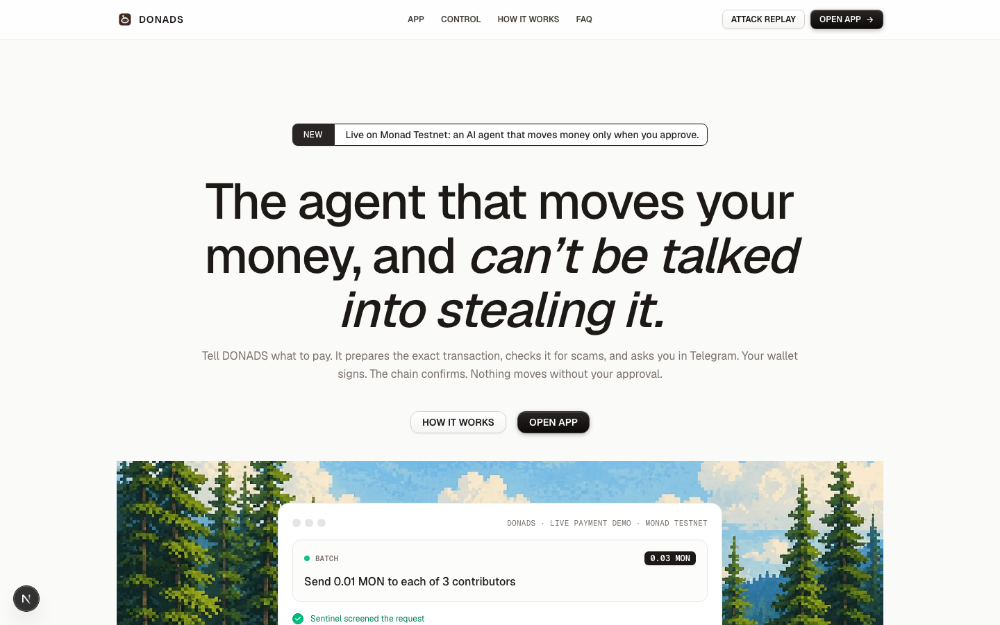
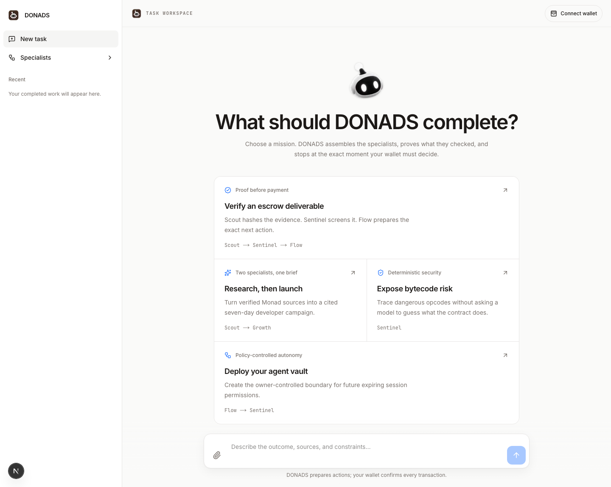

<div align="center">


# DONADS

**The AI agent that moves your money on Monad, and can't be talked into stealing it.**

[](https://donads.impiclabs.com)
[](https://monadscan.com/address/0x3738c66942683bc963FB7B6348AdAC71C194c81D)
[](https://t.me/doonads_bot)

[Live app](https://donads.impiclabs.com) · [Demo on X](https://x.com/adityanishad987/status/2117955256055476644) · [Contracts](#deployed-contracts) · [Judging checklist](#judging-checklist) · [Run it yourself](#run-it-yourself)



</div>

---

## Quick links

| | |
|---|---|
| **Live URL** | https://donads.impiclabs.com |
| **GitHub repo** | https://github.com/icancodefyi/monad-blitz-devcon-mumbai |
| **Demo (X post)** | https://x.com/adityanishad987/status/2117955256055476644 |
| **Telegram bot** | [@doonads_bot](https://t.me/doonads_bot) |
| **Mainnet contract** | [`0x3738…c81D`](https://monadscan.com/address/0x3738c66942683bc963FB7B6348AdAC71C194c81D) |

## Deployed contracts

| Network | Contract | Address | Explorer | Source |
|---|---|---|---|---|
| **Monad Mainnet** (chain 143) | `DonadsPolicyVault` | `0x3738c66942683bc963FB7B6348AdAC71C194c81D` | [monadscan.com](https://monadscan.com/address/0x3738c66942683bc963FB7B6348AdAC71C194c81D) | [Sourcify exact match](https://sourcify.dev/#/lookup/0x3738c66942683bc963FB7B6348AdAC71C194c81D) |
| Per deal | `DonadsEscrow` | One contract per deal, deployed from the chat | Link shown after each deal | [`contracts/src/DonadsEscrow.sol`](contracts/src/DonadsEscrow.sol) |

| Deployment record | Transaction |
|---|---|
| Mainnet vault | [`0x6b8e988b…ec35b86`](https://monadscan.com/tx/0x6b8e988bf311ceacdd24fdd17af465c9ffdef157c628dee8c99c44328ec35b86) · [`mainnet.json`](contracts/deployments/mainnet.json) |

## Judging checklist

Where to find the evidence for each item of the Monad Blitz rubric.

### Basic: prize eligibility (100)

| Item | Pts | Evidence |
|---|---:|---|
| Public GitHub repo | 25 | ✅ [icancodefyi/monad-blitz-devcon-mumbai](https://github.com/icancodefyi/monad-blitz-devcon-mumbai) |
| Proper README with live page and contract address | 25 | ✅ This file: [live URL](#quick-links) and [contract addresses](#deployed-contracts) |
| Smart contracts deployed on Monad | 25 | ✅ [`DonadsPolicyVault` on Monad Mainnet](https://monadscan.com/address/0x3738c66942683bc963FB7B6348AdAC71C194c81D), plus an escrow contract per deal |
| Project publicly hosted | 25 | ✅ https://donads.impiclabs.com |

### Project working (100)

| Item | Pts | Evidence |
|---|---:|---|
| All announced functions working | 25 | Every feature is in [What you can do](#what-you-can-do). Parts that are demo or simulated are named in [Limitations](#limitations) and labelled in the app |
| Live transaction on chain during the demo | 25 | Shown live: a Telegram-approved transfer, then its receipt on the explorer |
| Contract verified on the explorer | 25 | ✅ Source published and matched: [Sourcify exact match](https://sourcify.dev/#/lookup/0x3738c66942683bc963FB7B6348AdAC71C194c81D) |
| Someone else can run it from the README | 25 | ✅ [Run it yourself](#run-it-yourself), from `git clone` to a working app |

### Build in public (100)

| Item | Pts | Evidence |
|---|---:|---|
| Posted about the project on X | 25 | [Demo post on X](https://x.com/adityanishad987/status/2117955256055476644) |
| Demo video, creative ad video, 5K+ views | 75 | See the posts linked above and on the team's X account |

### Bonus (100)

| Item | Pts | Evidence |
|---|---:|---|
| Contracts deployed on Monad Mainnet | 25 | ✅ [`DonadsPolicyVault` on mainnet](https://monadscan.com/address/0x3738c66942683bc963FB7B6348AdAC71C194c81D) |
| Public page on a custom domain | 15 | ✅ https://donads.impiclabs.com |
| Pre-market fit | up to 20 | [Who it is for](#who-it-is-for) |
| Revenue potential and strategy | up to 20 | [How it makes money](#how-it-makes-money) |
| Innovation and originality | up to 20 | [What is new](#what-is-new) |

## The problem

AI agents are being given wallets, and they can be tricked. In May 2026 an attacker sent Grok a message in Morse code, and the Bankr-connected wallet behind it sent out roughly $150,000 to $216,000 ([Cointelegraph](https://cointelegraph.com/magazine/grok-bankr-wallet-free-nft-prompt-injection), [OECD AI incident log](https://oecd.ai/en/incidents/2026-05-04-4a73)). The AI held the power to move money, so tricking the AI meant taking the money.

## How DONADS works

DONADS keeps thinking and moving money apart.

1. **The AI can't set an amount or an address.** Plain code reads them from what you typed. Requests that carry hidden instructions are refused.
2. **Nothing moves without you.** You approve the exact transfer in Telegram, then sign it in MetaMask.
3. **Nothing is "done" until Monad says so.** DONADS checks the mined receipt (sender, recipient, amount, calldata) before it reports success.

DONADS never holds your keys. The server cannot sign a transaction.

<div align="center">

</div>

## What you can do

Type these in the DONADS chat after connecting MetaMask.

| Feature | Example | What happens |
|---|---|---|
| **Transfer** | `Send 0.01 MON to 0x…` | Exact intent, Telegram approval, wallet signature, receipt check |
| **Batch** | `Send 0.01 MON to each of 0xA, 0xB, 0xC` | Up to 10 recipients in one reviewed batch |
| **Token transfer** | `Send 10 USDC token 0xTOKEN to 0xRECIPIENT` | Reads the token contract, checks balances, verifies the balance change |
| **Telegram approvals** | (automatic) | Full addresses, amounts and total in Telegram with ✅ Approve and ❌ Reject |
| **Escrow** | `Create escrow 0.05 MON for 0xSELLER with arbiter 0xARBITER refund after 24 hours terms Logo delivered` | Deploys a funded escrow. `Release escrow 0x…`, `Timeout refund escrow 0x…`, `Dispute escrow 0x… evidence …` |
| **Best-offer finder** | `Find the best offer for a logo design under 0.05 MON` | Ranks offers by price, then delivery, then completed deals. The top one goes to Telegram, and **Go** opens the escrow for you to sign |
| **Buy and sell orders** | `/sell 10 MON at 0.5` or `/buy 10 MON at 0.5` in Telegram, or `Sell 10 MON at 0.5` in the chat | Matches your order against other wallets, then a labelled demo market. Go or Skip in Telegram. Go on a sell locks your MON in an escrow you sign. `/orders` and `/cancel` manage them |
| **Scheduled payments** | `Pay 0.01 MON to each of 0xA, 0xB every 2 minutes` | Each run prepares the exact batch and asks in Telegram. A run is skipped while the last one is waiting. `Stop my scheduled payments` ends it |
| **Wallet watch** | (automatic for Telegram-linked wallets) | Alerts for unlimited token approvals, approve-all NFT grants, and tokens from unknown contracts |
| **Lookalike block** | (automatic) | Stops a transfer to an address that imitates one you've paid before (address poisoning) |
| **Scam checks** | (automatic) | Sentinel screens links, seed-phrase requests and dangerous approvals before anything runs |
| **Research** | `Compare these docs https://…` | Scout reads the pages you give it and returns cited findings, flagging hidden instructions |
| **Policy vault** | `Deploy my policy vault` | Deploys an owner-controlled vault for future bounded sessions |

## Attack replay

[`frontend/src/server/attack-replay.test.ts`](frontend/src/server/attack-replay.test.ts) pushes attacker text through every input path. It passes only if no transfer is prepared and no task changes.

- **Chat:** Morse, base64, hidden HTML comments, "ignore previous instructions", role hijacks, invisible characters
- **AI planner:** the model returning a payment, or inventing source URLs
- **Scout:** a web page that instructs a MON transfer
- **Telegram:** free-text transfer requests, and forged or malformed button payloads

Run it with `npm test -- attack-replay` in `frontend/`.

## Who it is for

- **Teams paying people.** Contributors, freelancers and small DAOs who pay in MON and want each payment reviewed, in one batch or on a schedule.
- **People dealing with strangers.** Escrow and the best-offer finder hold money until delivery is confirmed.
- **Anyone running an AI agent.** The agent does the legwork, and the money moves only on your approval and signature.

## How it makes money

This is the plan, not something running today. Approvals, scam checks and alerts stay free. A small fee on escrow and batch settlement is the revenue line, and it grows with the volume of deals that go through DONADS.

## What is new

- **The AI has no authority over money.** Amounts and addresses come from plain code, and payment requests never reach the model.
- **Approval and signature are separate.** You decide in Telegram, and only your wallet can sign.
- **Every claim is checked against the chain.** A result is reported only after the receipt matches what you approved.
- **The attacks are replayed on every test run**, so the safety claim is tested, not just stated.

## Architecture

```text
Browser (Next.js, wagmi + RainbowKit, MetaMask)
  -> /api/v1  (wallet-signed session)
       -> Neon Postgres  (tasks, approvals, schedules, orders, watch state)
       -> Gemini         (optional, routing only; payment requests skip the model)
       -> Monad JSON-RPC (balances, receipts, logs)
  -> /api/telegram/webhook   <-  Telegram (approvals, Go/Skip, order commands)
  -> /api/cron/schedules     <-  scheduler (scheduled payments)
  -> /api/cron/watch         <-  scheduler (wallet alerts)
  -> MetaMask signs every transaction
```

## Run it yourself

You need Node.js 22 or newer, a free [Neon](https://neon.tech) Postgres database, and MetaMask with some MON from the [Monad faucet](https://faucet.monad.xyz).

```bash
git clone https://github.com/icancodefyi/monad-blitz-devcon-mumbai.git
cd monad-blitz-devcon-mumbai/frontend
cp .env.example .env.local
```

Edit `frontend/.env.local`:

| Variable | Value |
|---|---|
| `DATABASE_URL` | Your Neon connection string. Tables are created automatically on first use |
| `NEXT_PUBLIC_REOWN_PROJECT_ID` | A free project id from [cloud.reown.com](https://cloud.reown.com) |
| `DONADS_ALLOWED_ORIGINS` | `http://localhost:3000` |

Then:

```bash
npm ci
npm run dev
```

Open http://localhost:3000, click **Open app**, connect MetaMask and sign in.

### Telegram (approvals, offers, orders, schedules, alerts)

1. Create a bot with [@BotFather](https://t.me/BotFather).
2. In `.env.local` set `TELEGRAM_BOT_TOKEN`, `TELEGRAM_BOT_USERNAME`, `TELEGRAM_WEBHOOK_SECRET` (`openssl rand -hex 32`), `CRON_SECRET` (`openssl rand -hex 32`), `TELEGRAM_DELIVERY=polling`, and `DONADS_PUBLIC_APP_URL` to a public https URL of the app. Telegram does not accept localhost links.
3. In a second terminal run `npm run telegram:poll`. It forwards Telegram updates to the local app and triggers scheduled payments and wallet watch every 30 seconds. Nothing on your machine is exposed to the internet.
4. In DONADS, open the bell icon, choose **Connect** under Telegram approvals, and press Start in the bot.

### Checks

```bash
npm test        # unit, security and attack replay tests
npm run lint
npm run build
```

### Contracts

```bash
cd ../contracts
npm ci
npm run compile
npm test                 # Solidity unit, fuzz and invariant tests
CONFIRM_MAINNET=yes npm run deploy:mainnet   # needs MAINNET_DEPLOYER_PRIVATE_KEY in contracts/.env.mainnet; refuses any chain except 143
```

## Limitations

- **The order market is a demo.** Prices are in `tUSD`, a display unit and not a token. Counterparties without a real wallet behind them are labelled demo wallets. A buy against a demo seller is simulated: no MON is locked and no transaction is recorded.
- **Offers come from test sellers.** No real marketplace is connected.
- **Swaps are disabled** until official Uniswap contracts are live on Monad.
- **The policy vault does not spend on its own yet.** Delegated execution needs exact action binding and a review.
- **The lookalike check** compares the first and last four characters with addresses you have already paid through DONADS.

## More documentation

- [Product definition](PROJECT.md)
- [Current state](docs/architecture/current-state.md) and [decisions](docs/architecture/decisions.md)
- [Acceptance matrix](docs/acceptance-matrix.md)
- [Mainnet runbook](docs/mainnet-runbook.md)
- [Contract fuzz and invariant evidence](docs/security/contract-fuzz-invariants-2026-11-03.md)
